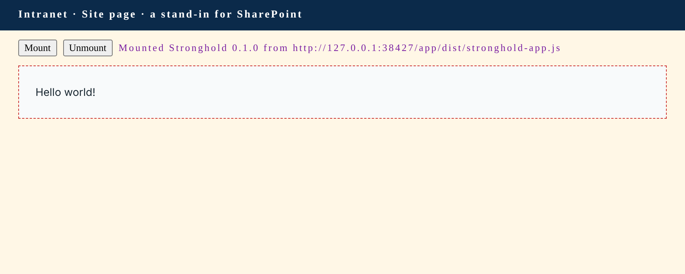

# Stronghold · the proof

The first code for [Stronghold](https://github.com/aliaseddd/Stronghold): one web page that says "Hello world!", built the way `ARCHITECTURE.md` plans the whole app. The plan calls this the proof (`ARCHITECTURE.md`, The proof): a small app, built with current tools, loaded by a thin SharePoint Framework (SPFx) host from the host's own package. This repository is where the experiment lives; the decisions and the design stay in the Stronghold repository.



## What's here

| Folder | What it is | Built with |
|---|---|---|
| `app/` | Stronghold itself: the shell, the hello module, the `HostServices` contract, and the loader every host uses. | webpack 5, TypeScript 5.9, Node 22+ |
| `hosts/server/` | The web part for SharePoint Server. | SPFx 1.4.1, TypeScript 2.4, Node 8 |
| `hosts/online/` | The web part for SharePoint Online, which is also the Teams tab. | SPFx 1.24.1, Heft, Node 22.14+ |
| `hosts/dev/` | A plain page that mounts the app the way the SharePoint hosts do, and the Chromium test. Never ships. | tsc, Playwright |
| `docs/` | The screenshot above, the Teams icon source, and the repo map aider drew. | |

Each folder has a README that says why it is the way it is.

## How it fits together

1. `app/` builds a handful of flat files, each named with a hash of its contents: the entry file, one file per module, and the font files. A small JSON says which file is the entry.
2. A host's build reads that name into its own code (`hosts/*/scripts/prepare-shared.js`) and copies the files into its SharePoint package, next to the host's bundle (`hosts/*/scripts/copy-app.js`).
3. On a page, the host's web part asks SharePoint where its files were served from, adds one `<script>` for the entry file there, and waits for `window.Stronghold` (`app/src/host/load-app.ts`). It has no settings: it only ever loads the app from its own package.
4. It calls `Stronghold.mount(container, services)`. The app draws inside a shadow root with the design's tokens and font, loads the hello module's file, and the module says hello.

No inline script, no `eval`, no Microsoft Graph, nothing fetched from the internet at run time.

## Build it

```sh
# 1. The app (Node 22 or later)
cd app && npm install && npm test && npm run build && cd ..

# 2. Try it in Chromium (the browser download is a one-time step per machine)
cd hosts/dev && npm install && npx playwright install chromium && npm test && cd ../..

# 3. The Server package (Node 8.17.0, or Docker)
hosts/server/build.sh            # → hosts/server/sharepoint/solution/stronghold-server.sppkg

# 4. The Online package (Node 22.14+, 24, or 26, or Docker)
cd hosts/online && npm ci && npm run build   # → sharepoint/solution/stronghold-online.sppkg
```

## What was checked, and what wasn't

Done here on November 2, 2026, in a Linux container:

| Check | Result |
|---|---|
| The app type-checks, and its two shared host files compile with TypeScript 2.4.2 | Yes (`app: npm test`) |
| The app builds: an entry file under 15 KiB, a hello module under 400 bytes, three font files | Yes |
| In Chromium: "Hello world!" inside a shadow root, the module file fetched on its own after the entry, the page's hostile CSS kept out, Inter loaded from the app's files, one script tag per page, clean unmount and remount, and the loader's failure paths (a missing file, a file that registers nothing, two callers at once) | Yes, nine tests (`hosts/dev: npm test`) |
| The Server package builds with the real SPFx 1.4.1 toolchain on Node 8.17.0, with no lint warnings, and the `.sppkg` holds the app's files in `ClientSideAssets` next to the web part bundle | Yes |
| The Online package builds with SPFx 1.24.1 on Node 22, and the `.sppkg` holds the app's files and the Teams icons | Yes |

Not done here:

- Installing either package and opening the page in Chrome, and Teams. That needs someone with access to the farm and the tenant. The READMEs in `hosts/server` and `hosts/online` list exactly what to look at.
- Running either `build.sh` under Docker: this container has no Docker daemon. The Server package was built with Node 8.17.0 installed directly, which is what the script does inside the `node:8.17.0` image. Proof step 5 is that script on a machine with Docker.
- Proof step 4, the signed-in person and the REST API. `HostServices` is empty until then.

## What this code takes from the plan

**Decided** (`DECISIONS.md`): one app with small hosts; the hosts are the only SPFx code; SharePoint data through the REST API; built for Chrome; the first code is the proof on SharePoint Server.

**Assumed**, under the open question "Which SharePoint Server version?": SPFx 1.4.1 for the Server host. It runs on SharePoint Server 2019 and on Subscription Edition, so those answers only decide whether 1.5 becomes an option. A 2016 answer would send the Server host back to SPFx 1.1, as `ARCHITECTURE.md` notes.

**Proposed, not approved.** This code follows these parts of `ARCHITECTURE.md`, and they still wait for Damon:

- Two SPFx hosts, with the Online web part doubling as the Teams tab, plus a dev host that never ships.
- The folder layout: `app/`, `hosts/server/`, `hosts/online/`, `hosts/dev/`.
- `HostServices` written for TypeScript 2.4 as the only shared code. This proof shares one more file the same way, the loader, because both hosts load the app identically.
- Loading the app with a `<script>` element from the package's own files; drawing in a shadow root; fonts declared on the page.
- One package per SPFx host. That is the open question "Does one package now mean one package per host?" This proof builds two packages because one `.sppkg` can't target both SPFx 1.4.1 and 1.24.1. The October 31 decision said one package.
- The bundler. The plan leaves it to the proof; this attempt uses webpack 5, and `app/README.md` says why.
- The shell's module registry, with one `import()` per module (`app/src/shell/registry.ts`).
- The styling proposals the hello page already uses: the design's tokens as CSS variables on `:host`, and the fonts bundled in the package instead of loaded from Google Fonts.
- Tests. The plan proposes Jest, or Vitest if the bundler is Vite. This proof tests in Chromium with Node's test runner and Playwright instead (`hosts/dev/test`), because what the proof has to show happens in a browser: the shadow root, the font, the module file loading. A unit test runner adds nothing to hello world; it comes with the first screen that has logic to test.

Not used, by choice: React (proposed for the screens; hello world doesn't need it), SCSS modules, Tailwind, Fluent UI.

## Facts that update the plan's notes

`ARCHITECTURE.md` marks its toolchain notes as unconfirmed search results. These come from Microsoft's documentation source (the `SharePoint/sp-dev-docs` repository as it stood on November 2, 2026; the compatibility and setup pages are dated October 29, 2026, the Teams pages October 28, 2026, and the SharePoint Server 2019 and Subscription Edition page February 14, 2020) and from the SPFx generator packages on npm:

- Current SPFx is **1.24.1** (1.24 went GA on October 28, 2026). It needs **Node 22.14+, 24, or 26**, uses **TypeScript 5.8** and **React 18.3.1**, and builds with **Heft**. The gulp toolchain is unsupported from 1.24 on.
- **SharePoint Server 2019** supports SPFx 1.0 to 1.4.1. **Subscription Edition** supports 1.0 to 1.5. **2016 with Feature Pack 2** supports 1.0 to 1.1. So 1.4.1 is right for 2019 and Subscription Edition, and only a 2016 answer would change the Server host.
- The on-premises scaffold still comes from the **1.10.0 generator** with the `onprem19` environment, which writes SPFx 1.4.x dependencies. Its templates are what `hosts/server/` follows.
- SPFx 1.4.1's `--ship` build fails on any tslint warning, and reads its lint rules from `config/tslint.json`, not the root `tslint.json` later generators write.
- Under Node 8, npm runs install scripts as `nobody` when it is root, so a container build needs `--unsafe-perm`.
- SPFx 1.4.1 web parts have no `supportedHosts`; the Teams tab exists only in the Online package.

## Next

1. Install `stronghold-server.sppkg` on the SharePoint Server farm and go through the checks in `hosts/server/README.md`. That settles proof steps 1, 2, and 3. Step 5 is `hosts/server/build.sh` on a machine with Docker.
2. Decide the proposals above, starting with one package per host.
3. Proof step 4: grow `HostServices` with the signed-in person and the REST client, in both hosts and the dev host.
4. The same checks on SharePoint Online and in a Teams tab.

## Changes for the Stronghold repository, once decided

Nothing in the Stronghold repository was changed for this proof. These are the lines it makes stale, for Damon to apply when he decides:

- `README.md` ("There's no code yet"), `ARCHITECTURE.md` (its first lines), and `CLAUDE.md` (its first paragraph): point at this repository and say the proof exists and what it has shown.
- `ARCHITECTURE.md`, Toolchain: replace the unconfirmed notes with the facts above (SPFx 1.24.1, Heft, Node 22.14+/24/26, TypeScript 5.8, React 18.3.1; 2019 up to 1.4.1, Subscription Edition up to 1.5, 2016 up to 1.1), and name the sources.
- `ARCHITECTURE.md`, "How a host loads the app": the bundler is webpack 5 in the proof, with the condition under which Vite comes back (`app/README.md`, "Why webpack 5").
- `ARCHITECTURE.md`, "The app and its hosts": the shared code is `HostServices` plus the loader, if that stands.
- `DECISIONS.md`: a row for each proposal above that Damon approves, with the date, and the answer to "one package per host".
