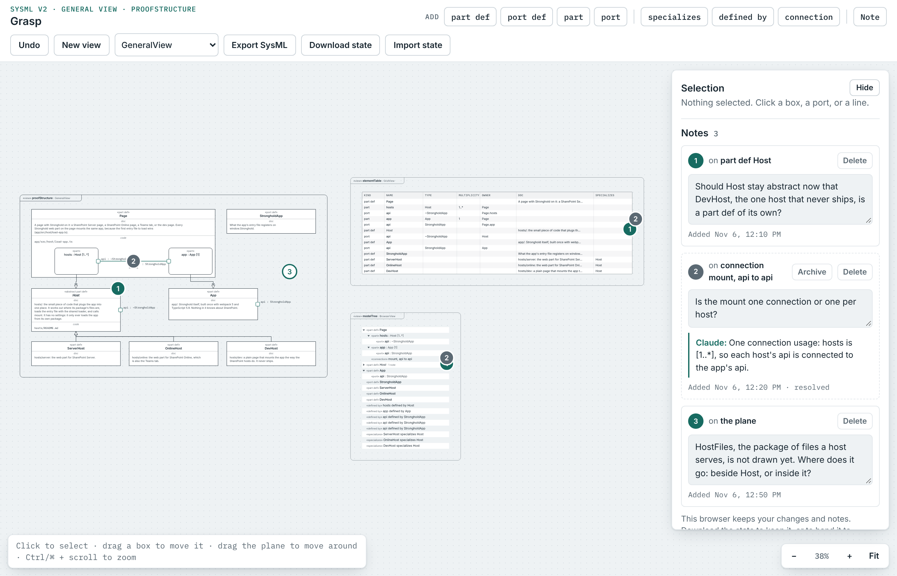

# The design canvas

`index.html` is a SysML v2 model drawn on an endless plane, in one HTML file with its script inline. The model is drawn in views, one frame per view, in any of the eight standard view kinds: a general view, an interconnection view, an action flow view, a state transition view, a sequence view, a geometry view, a grid, and a browser. You draw the elements each kind admits and the lines between them; the page checks the model as you draw; you pin notes to any box, port, or line, or leave them free on the plane; the drawing exports as textual SysML v2 that the SysML v2 Pilot Implementation's own validator accepts; and Undo takes back any change to the model. Claude reads your notes and changes the model on its side of the loop. This is the second slice of the design artifact described in the Stronghold developer log: the first proved the loop with one view kind, and this one adds what the log deferred.



## What it does

- **An endless plane with several views.** Each view is a frame with a tab, `«view» name : Kind`, that grows with what it shows; drag the tab to move the view. New view adds a frame of the kind picked beside the button, to the right of the others. The active view, named in the top left, is the one the palette draws into; clicking inside a frame makes it active. Drag the plane to move around, scroll to pan, pinch or hold Ctrl or ⌘ while scrolling to zoom; Fit brings every frame back. An element belongs to the model once and may be shown in any number of views: a view's panel has a Show list for what it doesn't show yet, Remove from view takes an element out of one view, and Delete takes it out of the model with everything inside it and every line on it.
- **The eight standard view kinds.** The palette follows the active view's kind.
  - *General view*: `part def`, `port def`, `part`, and `port`; the lines *specializes* (a hollow triangle at the general end), *defined by* (the same triangle with two dots, from a part to its part def or a port to its port def, drawn or not), and *connection* (between two ports or two parts). A part dropped inside a part def or a part belongs to it; a port sits on the border of whatever you click; a port's glyph shows which way its definition's items go.
  - *Interconnection view*: the structure kinds plus `item def`, `item` (with a direction when it sits in a port def), and `interface def` with its end ports; the lines *connection*, *interface* (between two ports, typed by an interface def or not), *flow* (of an item, through the ports' directed items or between items on parts, a filled arrowhead), and *binding* (`=`, between two ports or items of one definition).
  - *Action flow view*: `action def`, `action` (plain, or a send or accept with its payload and target), parameters on an action's border with their direction, fork and join bars, decision and merge diamonds, start and done; the lines *succession* (dashed, open arrowhead, with a guard `[g]` or `else` out of a decision), *flow* and *binding* between parameters.
  - *State transition view*: `state def`, `state` (parallel or not, nested), an initial node, entry, do and exit actions inside a state, done; *transition* lines labelled `trigger [guard] / effect`.
  - *Sequence view*: lifelines (parts) with a head and a dashed line down, events on a lifeline, *messages* between lifelines or events (named, with a payload item def, in the order the panel gives them; the arrows under a message move it up or down), and *successions* between events.
  - *Geometry view*: parts and items drawn to scale in a plan, with a shape (Box, Rectangle, CircularCylinder, Sphere, CircularCone), its dimensions, a position in the owner's frame, and a unit; a coordinate frame with axes and a scale bar; the view's own scale and unit in its panel. Dragging a footprint changes its position in the model.
  - *Grid*: a table of elements (the columns kind, name, type, multiplicity, owner, doc, specializes, notes, problems; click a header to sort) or a matrix of the relationships between them; Show all and Show kind in the panel fill it.
  - *Browser*: the model as a tree with disclosure triangles, under the roots the panel picks. It shows every element, so an element in no other view is found and selected here.
- **Checks while drawing.** The model is validated after every change: an element or line with a problem gets a red outline and a `!` badge, the count sits under the hint and clicking it selects each offender in turn, and the panel lists the selection's problems under its fields. The export panel keeps the full list. The palette refuses, in words, what the validator would refuse: a connection across definitions, a succession into a start, a transition between states in different state defs, a second entry action, and so on.
- **Undo.** The Undo button, and Ctrl or ⌘ + Z on the drawing, take back the last change to the model: an element placed, moved, renamed, retyped or deleted, a line drawn, a view added, moved, renamed, folded or deleted, a field edited (one step per field), a code link changed. Up to a hundred steps. Notes and pins are not undone: they have their own Delete, Archive and Restore, and Claude writes into them from its side. A model that arrives from the shared store starts the history afresh.
- **The selection panel.** Click a box, a port, a line, or a view's tab to see and change its fields: the name, the doc, what it is defined by, its multiplicity, and the fields of its kind (a direction, a guard, a trigger, a shape's dimensions…). A view's panel shows its name, its doc, its Show list, and its kind's options.
- **Notes on elements, on lines, and on the plane.** Select something and Add note, or use the Note tool: on an element or a line it adds a note there, on the plane it leaves a free note at that point. A note is listed in the panel and pinned on the drawing with its number, in every view that draws what it is on; a free note's pin is hollow and sits where it was left. Drag a pin onto an element or a line to move the note there, or onto the plane to set it free. The number takes you to the pin. A note Claude has answered shows the answer under it, and a resolved one is drawn dashed.
- **The archive.** A resolved note can be archived: it leaves the list and the drawing, keeps its number and its resolution, and sits under Archive at the bottom of the notes, from where Restore brings it back.
- **Code attached to elements.** An element can carry code links: a path, a language, and the text. They are listed in the panel's Code section and shown as a `code` compartment on the box; in the export they are textual representations inside the element.
- **Export SysML.** The model as textual SysML v2, with every view declared, each note as an issue with its status, and each code link as a `rep`. Problems that keep the text from being correct SysML are listed above it. Copy puts it on the clipboard.

## How the loop works

The design is worked on in a loop, and git is its memory between conversations.

1. **Load.** Claude publishes `index.html` to its page on claude.ai, https://claude.ai/artifact/V7Fw94cGMbtPnwmyDNmnjU. The page is private until it is shared from its Share menu. It starts from the model, the notes, and the archive saved in the file.
2. **Draw and annotate.** You change the drawing and pin notes. On the published page, every change saves as you work, into the page's own store, where Claude reads it.
3. **Review and respond.** You ask Claude to look. Claude reads the working model, the notes, and the archive from the store, exports the model with `export.mjs`, checks it with `check.sh`, makes the changes the notes ask for, answers each note, and republishes the page. The page picks up the new model.
4. **Save.** When you say so, Claude writes the model, the notes, and the archive into `index.html` with `save-state.mjs` and commits. Nothing reaches GitHub until then.

Where the model and the notes are kept:

- **On the published page**, in the page's store: one document, `model/working`, holds the working model as `{ baseRevision, model, changes, updated }`, where `baseRevision` is the `revision` of the model saved in the file the page was published from and `changes` is a list of `{ at, text }` saying what was done, newest last. A collection `notes` holds one document per note, named by the note's id, with `no`, `target` (the id of the element or line it is on, or `null` for a note on the plane, which then carries `x` and `y`), `targetLabel`, `text`, `by` (`user` or `claude`), `created`, `updated`, `response`, and `resolved`. A collection `archive` holds the archived notes the same way, each with `archived` (when) and `resolution` (the response at the time). Archiving is set `archive/<id>` then delete `notes/<id>`; restoring is the reverse. The page ignores a working model whose `baseRevision` is not the file's, so a republished file starts clean.
- **In git**, inside `index.html`: the model between `<!-- model:start -->` and `<!-- model:end -->`, the notes and the archive between `<!-- notes:start -->` and `<!-- notes:end -->` as `{ saved, notes, archive }`.
- **Opened as a file** in a browser, the page needs no server. It starts from what is saved in it and keeps your changes in that browser. Download state saves them as `canvas-state.json` (`{ model, notes, archive, changes }`), which Import state, or `save-state.mjs`, takes back.

The model's format is `stronghold-canvas/2`: `elements` carry their meaning (kind, name, owner, the fields of their kind, code links), `relationships` their two ends and fields, and each of the `views` its kind, name, doc, place on the plane, options, and a `layout` saying where each element it shows sits (a box's place and size relative to its nearest owner shown in the same view, a border item's side). A format-1 file, or an element written by hand with `x` and `y` of its own, is read and placed into the first view on load.

How Claude responds to a note: it sets `response`, and `resolved` once the note is dealt with, on the note's document. How Claude changes the model: it edits the model JSON, checks the export, and republishes the page with the new model saved in it, or writes the new model into `model/working` for the page to pick up live.

## The scripts

```sh
node canvas/export.mjs                     # the model saved in index.html, as textual SysML v2
node canvas/export.mjs canvas-state.json   # a state file, the same way
canvas/check.sh [canvas-state.json]        # export, then check with the pilot implementation's validator
node canvas/save-state.mjs canvas-state.json   # write a state into index.html, with a new revision
node --test --test-timeout=120000 canvas/test/*.test.mjs   # the Chromium tests, one process per file
```

`export.mjs` runs the page's own model script (`<script id="model-lib">` in `index.html`) in Node, so the text it prints is the text the Export button shows. `check.sh` hands that text to `docs/sysml/check.sh`, which runs the validator inside the pilot implementation's Jupyter kernel; its first run downloads the kernel. The tests need Playwright and Chromium the way `hosts/dev` does; `canvas/test/fixtures/` holds a state file per view kind, each of which `canvas/check.sh` accepts, and the model-library test exports every one of them.

## How the model is written out

The package first, then its imports when the model needs them (`ModelingMetadata` for the notes, the Geometry and units libraries for shapes and positions), then the definitions and the top-level usages, each with its body: the doc, the code links as `rep 'path' language "language" /* … */`, the elements it owns (a lifeline's events as one `then` chain, ports and parameters, nested boxes), and the lines declared in it, which belong to the innermost element that holds both ends, with paths like `hosts.api`. A part or port with the same name as a feature it inherits is written as a redefinition (`port :>> api`), which is what the validator expects. Then the lines declared at the top, the notes, and the views.

Each kind writes its own form: `in item x : T;` for a parameter, `action a send p via q;`, `fork f;`, `first a if g then b;` for a guarded succession and the `decide d;` block with its `if … then …;` and `else …;` lines, `entry; then s1;` for a state's initial node (or `entry action e;` and a transition from it), `transition t first s1 accept Sig if g do action a then s2;`, `message m of Item from a.e1 to b.e2;`, `interface link : Link connect a.p to b.q;`, `flow of Fuel from a.p.out to b.q.in;`, `bind a.p = b.q;`, and for a shape `item :>> shape : Box { :>> length = 2 [m]; … }` with the position as a translation of the part's coordinate frame. A note is `metadata <n3> : Issue about StrongholdProof::Host { text = "…"; }`, followed by `metadata Rationale about n3 { text = "…"; }` when Claude has answered and `metadata StatusInfo about n3 { status = StatusKind::open; }` (`done` once resolved, `closed` once archived, with the resolution as the rationale); a note on the plane is an issue about nothing, a note on an unnamed line is written inside the line's body, and a note on a specializes or defined-by line, which have no names in the textual notation, is about both of the line's ends with the line named in the text. Names that are not plain identifiers, or that are keywords, are quoted. The views come last: `view proofStructure : StandardViewDefinitions::GeneralView { expose StrongholdProof::*::**; }` for a view that shows everything, else one `expose` per shown element; a grid adds `render Views::asElementTable;`, a browser exposes its roots and adds `render Views::asTreeDiagram;`.

The model saved here is the Stronghold proof's structure from `docs/sysml/stronghold-proof.sysml`, restricted to what the first slice's palette could draw: the page, the app, the host and its three specializations, their ports, and the connection `mount`, in one general view. The attributes, the package `HostFiles`, and the end multiplicities on `mount` are left out.
