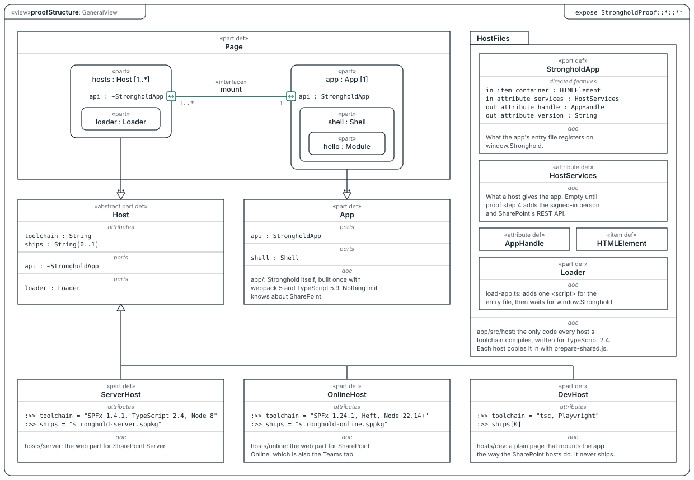

# SysML model

`stronghold-proof.sysml` is the proof's structure in SysML v2 textual notation: the page, the app, the three hosts, and the contract between them. `stronghold-proof.svg` draws the model's one view, `proofStructure`, a general view in SysML v2's graphical notation.

## What it says

- A `Page` holds one or more host web parts and exactly one app: every web part on a page mounts the same app, because the first entry file to load wins (`app/src/host/load-app.ts`). The `1..*` and `1` on the `mount` interface say that. The page isn't a folder here; it is where the hosts and the app meet at run time.
- A host reaches the app through a `StrongholdApp` port. The app has the port, and each host has its conjugate (`~StrongholdApp`), so what one side sends the other receives: the host sends the container and `HostServices`, the app sends back the `AppHandle` and its version. In the code, the port is `window.Stronghold`.
- `ServerHost`, `OnlineHost`, and `DevHost` specialize `Host`, so each one has the same loader and the same port. They differ in their toolchain and in what they ship.
- `HostFiles` is `app/src/host`, the only code every host's toolchain compiles.

## Reading the notation

- Square corners are definitions (`part def`, `port def`, `attribute def`, `item def`). Rounded corners are usages: a part inside the thing that owns it.
- A box inside a box belongs to it.
- A small square on an edge is a port. `~` before its type means the conjugate: the same features with `in` and `out` swapped.
- A hollow triangle means "specializes": each host specializes the `Host` its line's triangle touches. With two dots behind the triangle, it means "defined by": the part `hosts` is defined by `Host`.
- Compartments are named in italics. `:>>` redefines an inherited feature, so `:>> ships[0]` says the dev host ships nothing.

## Notes on the drawing

`stronghold-proof.html` is the same drawing on an endless plane you can move around and annotate. Open the file in a browser; it needs no server and no build. Drag the background to move around, scroll to pan, and pinch or hold Ctrl or ⌘ while scrolling to zoom; Fit brings the whole drawing back. Click to add a note. The note belongs to the element under the pointer (a box, a port, a line, or the view itself), and you can drag its pin onto another element or out onto the plane. A note's number in the list takes you to its pin.

Notes stay in the browser that made them. Save notes writes them to `stronghold-proof-notes.json`, Load notes adds the ones from such a file that aren't there yet, and Copy as Markdown lists them with each element's qualified name, ready for an issue or a chat.

## How it was checked

By reading, not by a tool. The model was checked against the SysML v2 textual grammar (`bnf/SysML-textual-bnf.kebnf`) and the training examples in the [SysML v2 release](https://github.com/Systems-Modeling/SysML-v2-Release), tag `2026-09.1`, construct by construct. It hasn't been parsed by a SysML v2 tool yet.

The drawing follows the release's graphical notation (`bnf/SysML-graphical-bnf.html`). It is laid out by hand in `draw.mjs`, not generated from the model, so a change to the model needs the same change there. Every `doc` line in the drawing is copied word for word from the model. `node docs/sysml/draw.mjs` writes `stronghold-proof.svg` and the drawing inside `stronghold-proof.html`, so the two stay the same.

To have a tool check the model, install the release's Jupyter kernel (`install/jupyter`, `jupyter-sysml-kernel` 0.63.1), paste the file into a cell, and run it. The kernel lists any errors, and `%viz StrongholdProof` draws the model.
